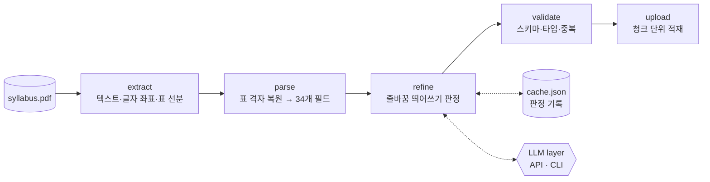

# Syllabus PDF → JSON Pipeline

대학 포털이 **PDF 한 파일로만** 제공하는 학기 강의계획서 약 2,000건을 구조화된 JSON으로 바꾸고, 서비스 DB에 적재하기 위한 파이프라인입니다.

PDF는 사람이 보기 위한 출력물이라 표 구조도, 원래 띄어쓰기도 텍스트 레이어에 온전히 남아 있지 않습니다. 이 프로젝트는 **PDF 그리기 명령에서 표를 복원**하고, **줄바꿈 때문에 사라진 띄어쓰기를 위치 정보 + 코퍼스 통계 + LLM 투표로 되살려** 강의계획서의 모든 항목(34개 필드)을 손실 없이 뽑아냅니다.

| | |
|---|---|
| 입력 | 6,975쪽, 56MB PDF 1개 (텍스트만 50MB 이상) |
| 출력 | 강의계획서 2,310건 × 34개 필드 JSON |
| 파싱 실패 | 0건 |
| 띄어쓰기 판정 | 애매한 줄바꿈 지점 12,351곳 (고유 문맥 8,723개) |
| 전체 소요 | 추출 약 2분, 파싱 75초, 정제는 캐시가 있으면 수 초 |
| 의존성 | Python 3.11+ 표준 라이브러리, poppler(`pdftotext`), `qpdf` |

## 파이프라인



| 단계 | 하는 일 |
|---|---|
| extract | `pdftotext -bbox`로 단어별 좌표를 페이지 단위 JSONL로 스트리밍 저장하고, `qpdf`로 압축을 푼 content stream에서 표 테두리 선분을 뽑습니다. |
| parse | 선분으로 표의 칸을 복원하고, 단어를 칸에 배정해 헤더·서술형 섹션·각종 표를 필드로 만듭니다. 서술형 텍스트는 줄 단위 좌표를 유지한 채 넘깁니다. |
| refine | 줄마다 "진짜 개행 / 자동 줄바꿈 + 공백 / 자동 줄바꿈 + 붙임"을 판정해 문자열로 합칩니다. |
| validate | 필드 순서, 타입, 과목코드 중복, 렌더링되지 않은 블록이 남았는지 검사합니다. |
| upload | 결과를 청크로 나눠 백엔드 import API에 multipart로 POST합니다. |

## 기술적으로 풀어야 했던 문제

### 1. 텍스트 추출로는 표가 깨진다
강의계획서의 절반 이상이 표(헤더 정보, 수업방식 비율, 교재, 주별 수업계획, 역량 가중치)입니다. 일반 텍스트 추출은 표를 공백으로 정렬된 줄로만 돌려줘서, 칸 안에서 줄바꿈된 교수명·과목명이 옆 칸 내용과 섞입니다.

→ PDF content stream의 `x y m` / `x y l` 선분 명령을 직접 읽어 **표 격자를 복원**하고, 각 단어를 자신을 둘러싼 가장 가까운 테두리 칸에 배정했습니다 (`segments.py`, `grid.py`). 칸 단위로 묶이니 여러 줄짜리 셀도 안정적으로 하나의 값이 됩니다.

### 2. 줄바꿈 지점의 띄어쓰기가 사라진다
이 PDF 생성기는 한글을 **글자 단위로 줄바꿈**하고, 줄바꿈 자리에 있던 공백을 기록하지 않습니다. 그대로 이으면 `학습하게 됩 니다`(잘못 띄움) 또는 `공간의활용`(잘못 붙임) 같은 오류가 문서 전체에 수만 곳 생깁니다.

→ 세 단계로 판정합니다 (`refine.py`, `wrapvote.py`).
1. **기하 판정:** 줄 끝 x좌표 + 다음 글자 폭 + 공백 폭이 칸 오른쪽 경계 안에 들어가면, 자동 줄바꿈이 아니라 원래 개행입니다. 들여쓰기 여부도 함께 봅니다.
2. **코퍼스 통계:** 50MB 전체 텍스트에서 토큰·바이그램·접두/접미 빈도를 세어 `A|B`가 한 단어로 더 자주 나오는지, 두 단어로 더 자주 나오는지 비교하고 조사 규칙을 더합니다.
3. **LLM 투표:** 애매한 지점은 50개씩 묶어 voter 모델에 묻고, voter와 통계 판정이 다를 때만 tiebreak 모델이 결정합니다(3자 중 2표).

판정은 `앞 25자|뒤 25자` 문맥을 키로 캐시해서, 다음 학기 PDF를 돌려도 **새로 생긴 문맥만** LLM에 묻습니다.

### 3. 페이지 경계에서 잘리는 표 행
주별 수업계획의 한 행이 페이지 경계에서 잘리면 주차 번호와 내용이 서로 다른 페이지에 찍혀, 내용이 다음 주차에 붙는 문제가 있었습니다. → 페이지 하단의 미완성 행을 보류했다가 다음 페이지 첫 빈 행과 합치는 방식으로 처리했습니다.

### 4. 강의마다 다른 표 구성
비율 표(수업방식·기자재·성적평가)는 강의마다 항목 이름과 개수가 달라 이름으로는 어느 표인지 구분되지 않습니다. → 섹션 머리글 사이의 **위치**로 표 종류를 분류했습니다.

### 5. 대용량 적재
34개 필드 전체를 담으니 결과가 13.5MB가 되었고, 한 번에 올리면 서버가 연결을 끊었습니다. → 항목이 서로 독립적으로 upsert된다는 점을 이용해 약 4MB 청크로 나눠 적재합니다. 실제 적재 후 2,310건을 다시 조회해 원본과 대조했고 모두 일치했습니다.

## LLM 레이어 (`llm/`)

판정 로직은 특정 모델이나 벤더에 묶이지 않습니다. 모든 백엔드는 `complete(prompt) -> str` 하나만 구현하고, TOML 설정으로 역할(voter / tiebreak)마다 다른 백엔드를 고를 수 있습니다.

| provider | 대상 |
|---|---|
| `openai` | OpenAI 호환 `/chat/completions` — OpenAI, OpenRouter, LiteLLM 같은 라우터, vLLM, Ollama |
| `anthropic` | Anthropic 공식 SDK |
| `cli` | 아무 CLI — 프롬프트는 stdin, 답은 stdout (`claude -p`, `ollama run`, `codex exec` …) |

```toml
# configs/router.toml
[refine.voter]                  # 애매한 줄바꿈 전부에 투표
provider = "openai"
base_url = "http://localhost:3001/v1"
api_key_env = "LLM_KEY"
model = "claude-haiku-5-5"
concurrency = 2
check_model = true              # 라우터가 다른 모델로 바꿔치기하면 실패 처리

[refine.tiebreak]               # voter와 통계 판정이 다를 때만
provider = "cli"
command = ["claude", "-p", "--model", "{model}", "--output-format", "text"]
model = "claude-sonnet-5-5"
```

예시 설정: `router.toml`(로컬 라우터), `anthropic.toml`(API 직접), `claude-cli.toml`(API 키 없이 Claude Code CLI), `mixed.toml`(로컬 모델 + CLI), `offline.toml`(LLM 없이 기하·통계만).
새 백엔드는 `llm/base.py`의 `Provider`를 상속해 `llm/__init__.py`의 `KINDS`에 등록하면 됩니다.

## 사용법

```bash
# 전체 실행 (적재 제외)
LLM_KEY=... python3 pipeline.py run syllabus.pdf work/

# 다른 LLM 설정으로 정제 단계부터 다시
python3 pipeline.py run syllabus.pdf work/ -c configs/claude-cli.toml --from refine

# 적재까지 ([upload] endpoint 설정 필요, 토큰은 환경변수)
UPLOAD_TOKEN=... python3 pipeline.py run syllabus.pdf work/ --upload

# LLM 연결 점검: 정답이 정해진 4문항을 각 역할에 보내 봄
python3 pipeline.py llm-test -c configs/anthropic.toml
```

- 단계: `extract` → `parse` → `refine` → `validate` → `upload` (`--from` / `--to`로 일부만 실행)
- 추출 결과는 작업 폴더에 캐시됩니다(`--force`로 재추출).
- API 키와 토큰은 설정 파일에 쓰지 않고 환경변수 이름만 적습니다.

## 출력 예시

값은 설명용 예시입니다.

```json
{
  "년도": 2026, "학기": "2학기", "과목코드": "0001234001", "과목명": "데이터구조",
  "이수구분": "전공필수", "학년": "2", "교수": "홍길동", "학점": "3", "강의": "3", "실습": "0",
  "요일교시강의실": "[07-301:화(3-4) 목(3-4)]",
  "교과목개요및목적": "자료구조의 기본 개념과 구현 방법을 학습한다.",
  "수업목표": "배열, 리스트, 트리, 그래프를 직접 구현하고 시간 복잡도를 분석할 수 있다.",
  "수업방식비율": {"강의": 70, "토론": 0, "세미나": 0, "실습": 30, "시청각": 0, "유인물": 0, "견학": 0, "기타": 0},
  "성적평가비율": {"시험": 60, "출석": 10, "과제": 30},
  "교재": {"주교재": [{"교재명": "자료구조론", "저자": "...", "출판사": "...", "발행년도": "2024"}], "참고서적": [], "기타서적": "강의 자료 제공"},
  "주별수업계획": [{"주차": 1, "내용": "강의 소개, 복잡도 분석"}, {"주차": 2, "내용": "배열과 연결 리스트"}],
  "과제": [{"번호": 1, "과제명": "연결 리스트 구현", "제출일": "...", "목표": "...", "진행방법및유의사항": "...", "참고자료": "..."}],
  "핵심역량가중치": {"지식탐구": 40, "의사소통": 10, "문제해결": 40, "창의융합": 10, "협업인성": null, "도전창조": null},
  "전공능력가중치": [{"전공능력": "소프트웨어설계능력", "가중치": 3}],
  "...": "총 34개 필드"
}
```

## 파일 구성

```
pipeline.py      단계 오케스트레이터 (run / llm-test)
dump_pages.py    pdftotext -bbox 출력 → 페이지별 단어 좌표 JSONL
segments.py      content stream → 표 테두리 선분
grid.py          선분으로 칸을 찾고 단어를 칸에 배정
parse_full.py    칸·섹션 → 34개 필드 (서술형은 줄 좌표 블록으로 유지)
refine.py        기하·코퍼스 통계·LLM으로 줄바꿈 판정, 문자열로 렌더링
wrapvote.py      LLM 프롬프트와 배치 투표
upload.py        검증 + 청크 multipart 적재
llm/             Provider 추상화 (openai / anthropic / cli)
configs/         LLM·적재 설정 예시
```
